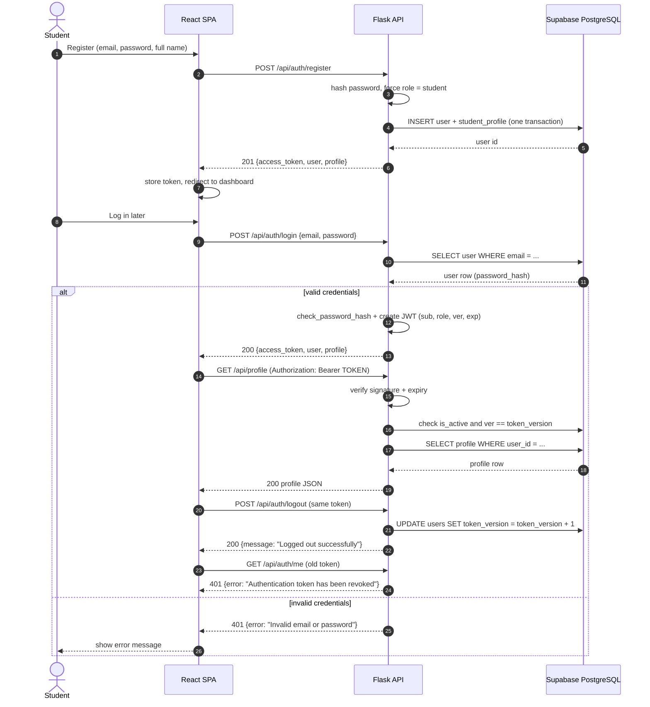
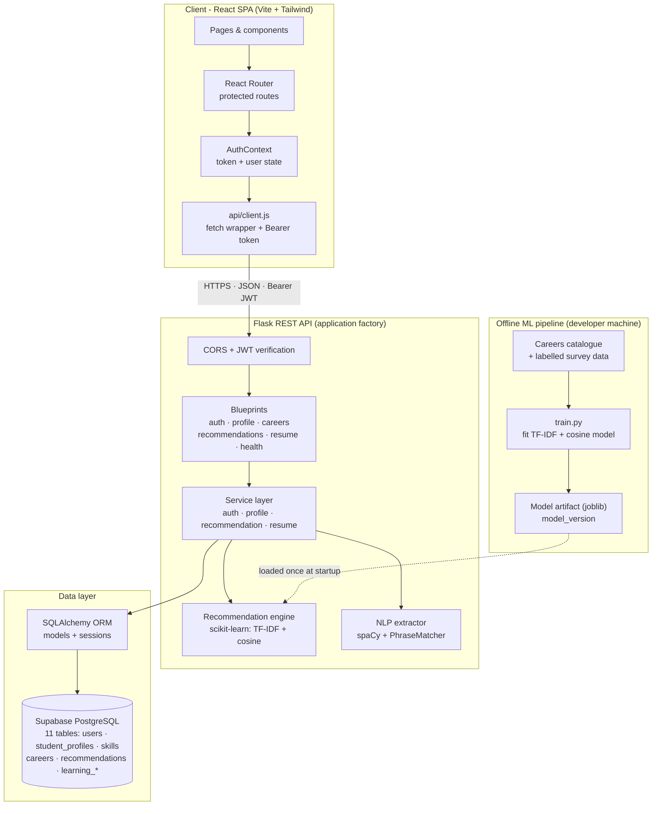

# Architecture — AI-Powered Career Guidance

> A scalable model for personalized recommendations.
> React SPA · Flask REST API · Supabase PostgreSQL · SQLAlchemy · scikit-learn · spaCy

This document describes the complete architecture of the application: how the
React client talks to the Flask API, how the API uses Supabase PostgreSQL, how
the ML recommender and the spaCy resume analyzer work, and how authentication
is handled end to end.

The design is intentionally **intermediate-level**: a classic 3-tier web
application plus one offline ML training script. No microservices, message
queues, container orchestration or vector databases are required.

---

## 1. System architecture

### 1.1 Style

The system is a **3-tier web application with an offline ML pipeline**:

| Tier | Component | Responsibility |
| --- | --- | --- |
| Presentation | **React SPA** (Vite + Tailwind CSS) | UI, routing, auth state, form validation, calling the REST API |
| Application | **Flask REST API** | Authentication, validation, business rules, recommendation orchestration, resume analysis |
| Data | **Supabase PostgreSQL** | Persistent storage (users, profiles, skills, careers, recommendations, learning resources) |
| Intelligence | **scikit-learn + spaCy** (inside the backend) | Career matching and skill extraction |
| Offline | **Training script** | Builds and versions the ML artifacts from the careers catalogue |

Supabase provides **only the managed PostgreSQL database** in this project.
Supabase Auth, Supabase Storage and supabase-js are **not** used — Flask is the
single client of the database and the single source of authentication.

### 1.2 Component responsibilities

| Component | Runs where | Key responsibilities |
| --- | --- | --- |
| React app | Browser (dev: Vite :5173) | Render pages, protect routes, attach JWT to requests, render results |
| Flask API | Server (dev: :5000) | REST endpoints, JWT verification, profile CRUD, calling ML/NLP services |
| Recommendation engine | Flask process | Load the TF-IDF model once, score careers for a profile, explain results |
| Resume analyzer | Flask process | Extract text → spaCy skill matching → return structured skills |
| Supabase PostgreSQL | Cloud | Store all persistent data, enforce constraints and indexes |
| Training script | Developer machine / CI | Fit the model from the DB careers catalogue, write a versioned artifact |

### 1.3 Backend layering

Every request follows the same path:

```
HTTP request
   │
   ▼
Blueprint (app/routes/)          validates input, checks JWT, returns JSON
   │
   ▼
Service (app/services/)          business rules, orchestration, transactions
   │  ├── ML engine (ml/)        scoring + explanations
   │  ├── NLP extractor (nlp/)   skill extraction
   │  └── ORM models (models/)   persistence via SQLAlchemy
   ▼
Supabase PostgreSQL
```

Rules that keep the codebase clean:

- **Routes stay thin.** No SQL and no ML code in route handlers.
- **Services own business logic.** They can be unit-tested without HTTP.
- **Models own persistence only.** No HTTP or ML logic in models.
- **One DB writer.** Only the Flask backend connects to PostgreSQL.

### 1.4 Target project structure

```
career-guidance/
├── frontend/
│   └── src/
│       ├── api/client.js              # fetch wrapper, base URL, JWT header, 401 handling
│       ├── context/AuthContext.jsx    # token + current user state
│       ├── components/                # Layout, ProtectedRoute, CareerCard, SkillTag, ...
│       ├── pages/                     # Login, Register, Dashboard, Profile, Recommendations, Resume
│       ├── App.jsx                    # router + providers
│       └── main.jsx
│
├── backend/
│   ├── app/
│   │   ├── __init__.py                # application factory
│   │   ├── config.py                  # env-based configuration
│   │   ├── extensions.py              # db, jwt instances
│   │   ├── cli.py                     # create-admin command
│   │   ├── models/                    # 11 SQLAlchemy models (see section 3.3)
│   │   ├── routes/                    # auth, profile, admin, careers, recommendations, resume, health
│   │   ├── schemas/                   # request schemas + serializers
│   │   ├── services/
│   │   │   ├── health_service.py
│   │   │   ├── auth_service.py
│   │   │   ├── profile_service.py
│   │   │   ├── recommendation_service.py
│   │   │   ├── resume_service.py
│   │   │   ├── ml/                    # features.py, engine.py, train.py
│   │   │   └── nlp/                   # extractor.py, skill_matcher.py
│   │   └── utils/                     # auth.py, errors.py, validation.py
│   ├── tests/                         # unittest suite (health, auth, validation, errors)
│   ├── models/artifacts/              # generated ML artifacts (git-ignored)
│   ├── run.py
│   └── requirements.txt
│
├── database/                          # schema.sql (reference) + setup notes
└── docs/
```

### 1.5 Runtime topology

| Component | Development | Production (suggested) |
| --- | --- | --- |
| Frontend | Vite dev server, `http://localhost:5173` | Static build (`npm run build`) on Netlify/Vercel |
| Backend | Flask, `http://127.0.0.1:5000` | Render/Railway single web service |
| Database | Supabase cloud Postgres | Supabase cloud Postgres |

The only configuration difference is the API base URL and the CORS origin.

### 1.6 Design principles and non-goals

**Principles**

1. **Stateless API** — a signed JWT carries identity; no server-side session store.
2. **Offline training, online inference** — the model is trained by a script and only *loaded* at request time.
3. **Interpretable recommendations** — every result carries matched/missing skills.
4. **Versioned models** — every stored recommendation records `model_version`.
5. **Configuration via environment** — secrets and URLs never live in code.
6. **Single database owner** — the Flask API; this keeps authorization logic in one place.

**Deliberately out of scope** (not needed for an intermediate BTech project):

- Microservices, message queues, background workers
- Docker/Kubernetes
- Vector databases or embedding stores
- LLM APIs / cloud AI services
- Redis or other caches
- Supabase Auth / supabase-js

---

## 2. Frontend and backend communication

### 2.1 Protocol and base URL

| Aspect | Decision |
| --- | --- |
| Style | REST over HTTP, JSON bodies only |
| Dev base URL | Relative `/api` via the Vite proxy (`vite.config.js` → `http://127.0.0.1:5000`) |
| Prod base URL | `VITE_API_BASE_URL` (e.g. `https://api.example.com/api`) |
| Auth header | `Authorization: Bearer <access_token>` |
| Content type | `application/json` (except resume file upload: `multipart/form-data`) |
| Dates | ISO-8601 UTC strings (`2026-10-31T09:30:00Z`) |
| Field naming | `snake_case` in JSON (Python convention); the frontend adapts |

The frontend never builds URLs by hand — everything goes through
`src/api/client.js`, a small wrapper around native `fetch` (no Axios needed):

```js
// src/api/client.js (design, implemented in M1)
async function request(path, { method = 'GET', body, auth = true } = {}) {
  const headers = {};
  if (body) headers['Content-Type'] = 'application/json';
  const token = localStorage.getItem('access_token');
  if (auth && token) headers.Authorization = `Bearer ${token}`;

  const res = await fetch(`${import.meta.env.VITE_API_BASE_URL ?? '/api'}${path}`, {
    method,
    headers,
    body: body ? JSON.stringify(body) : undefined,
  });

  if (res.status === 401 && auth) {
    localStorage.removeItem('access_token');
    window.location.assign('/login');
  }
  const data = await res.json().catch(() => ({}));
  if (!res.ok) throw new Error(data.error ?? `Request failed (${res.status})`);
  return data;
}
```

### 2.2 Endpoint catalogue

All endpoints are prefixed with `/api`.

| Method | Endpoint | Auth | Purpose |
| --- | --- | --- | --- |
| GET | `/health` | Public | Liveness / smoke test |
| GET | `/health/db` | Public | Database connectivity check (optional `?verbose=true`) |
| POST | `/auth/register` | Public | Create a student account + profile, return JWT |
| POST | `/auth/login` | Public | Verify credentials, return JWT |
| GET | `/auth/me` | JWT | Current user + profile (session restore) |
| POST | `/auth/logout` | JWT | Revoke all outstanding tokens for the current user |
| GET | `/profile` | JWT + student | Read the current user's profile |
| PUT / PATCH | `/profile` | JWT + student | Update the current user's profile |
| GET | `/profile/skills` | JWT + student | List the current student's technical skills |
| POST | `/profile/skills` | JWT + student | Add a technical skill by name |
| PUT / PATCH | `/profile/skills/{student_skill_id}` | JWT + student | Update a skill's proficiency |
| DELETE | `/profile/skills/{student_skill_id}` | JWT + student | Remove a skill from the profile |
| GET | `/careers` | JWT | Paginated careers catalogue (optional `?search=`) |
| GET | `/careers/{id}` | JWT | Career detail |
| POST | `/recommendations` | JWT | Score careers, persist and return top-N |
| GET | `/recommendations` | JWT | Latest saved recommendations (history) |
| POST | `/resume/analyze` | JWT | Extract skills from text/PDF (returns suggestions) |
| GET | `/admin/stats` | JWT + admin | Aggregate user/profile/career counts |
| POST | `/admin/careers` | JWT + admin | Manage the careers catalogue (M5, optional) |

Ownership rule: `/profile`, `/profile/skills/*`, `/recommendations` and
`/resume/*` always operate on the **current user** taken from the JWT
(`get_jwt_identity()`), never on an ID supplied by the client. Profile and skill
endpoints accept no `user_id`. Admin routes are the only exception and require
the current database role to be `admin`. Registration always creates a
`student`; a client-supplied `role` is ignored.

### 2.3 Request/response conventions

**Success**

```json
// 200 OK — a single resource
{ "id": 7, "email": "student@college.edu", "full_name": "Asha Rao", "role": "student" }

// 200 OK — a paginated collection
{ "items": [ { "id": 1, "title": "Data Analyst" } ], "total": 42, "page": 1, "page_size": 20 }

// 201 Created — register (login returns the same shape, without creating a profile)
{
  "access_token": "<jwt>",
  "token_type": "Bearer",
  "expires_in": 3600,
  "user": { "id": 7, "email": "student@college.edu", "full_name": "Asha Rao",
            "role": "student", "is_active": true,
            "created_at": "2026-10-31T12:00:00+00:00",
            "updated_at": "2026-10-31T12:00:00+00:00" },
  "profile": { "id": 3, "branch": "Undeclared", "semester": 1, "cgpa": null,
               "graduation_year": null, "bio": null, "interests": [] }
}

// 200 OK — logout (every previously issued token for the user is now invalid)
{ "message": "Logged out successfully" }
```

All timestamps are ISO 8601 UTC. User responses never include `password_hash` or
`token_version`.

**Errors** — a consistent envelope (matches the existing global handlers):

```json
{ "error": "Invalid email or password" }
{ "error": "Validation failed", "fields": { "cgpa": "must be at most 10" } }
```

| Status | Meaning in this API |
| --- | --- |
| 400 | Malformed JSON / wrong content type |
| 401 | Missing, malformed, expired or revoked JWT; bad credentials |
| 403 | Authenticated but not allowed (non-admin, admin on student profile, deactivated account login) |
| 404 | Resource not found (including a skill link owned by another student) |
| 405 | Method not allowed |
| 409 | Conflict (email already registered, duplicate profile skill, constraint violation) |
| 422 | Validation errors (missing or invalid fields, conflicting aliases) |
| 503 | Database unavailable |
| 500 | Unhandled server error |

Pagination: `?page=1&page_size=20` (max 100), response includes `items`,
`total`, `page`, `page_size`. The careers catalogue is small, but the pattern
keeps the API future-proof.

### 2.4 CORS and dev proxy

- Development: the Vite proxy makes requests same-origin from the browser, so
  CORS is usually transparent. `CORS_ORIGINS` in `backend/.env` still allows
  direct calls to `http://127.0.0.1:5000`.
- Production: set `CORS_ORIGINS` to the deployed frontend origin **only**
  (e.g. `https://career-guidance.vercel.app`). Do not use `*` with credentials.

### 2.5 Frontend responsibilities per request

1. `ProtectedRoute` checks that a token exists; otherwise redirect to `/login`.
2. `AuthContext` exposes `{ user, login, register, logout }` to pages.
3. Pages call `api.*` helpers (not `fetch` directly) and handle loading/error states.
4. On `401`, the client clears the token and redirects to `/login`.
5. Recommendations are **generated on demand** (`POST`) and cached in component
   state; the dashboard may re-fetch the latest saved set on mount.

---

## 3. Database communication

### 3.1 Supabase's role

Supabase hosts a standard PostgreSQL instance. In this architecture:

- **Only the Flask backend** connects to it, using a connection string.
- The frontend **never** talks to the database directly (no supabase-js).
- **No Supabase Auth**: password hashes and JWTs are handled by Flask.

This keeps one trust boundary: every read/write is authorized by the Flask API.

### 3.2 Connection and session management

```
Flask request → SQLAlchemy session → psycopg 3 → TLS → Supabase PostgreSQL
```

- Connection string: `SUPABASE_DB_URL` in `backend/.env`, with the
  `postgresql+psycopg://` driver prefix (e.g.
  `postgresql+psycopg://postgres:<password>@db.<project-ref>.supabase.co:5432/postgres?sslmode=require`).
- Flask-SQLAlchemy opens a session per request and closes it when the request
  ends; services call `db.session.commit()` explicitly and roll back on errors.
- Connection pooling is provided by SQLAlchemy (`pool_pre_ping=True` avoids
  stale connections). Keep the default pool size — one Flask instance does not
  need tuning for this project.
- When deploying behind Supabase's **connection pooler**, use the pooler URL
  shown in the dashboard. In transaction mode, disable psycopg client-side
  prepared statements (`prepare_threshold=None`) or use session mode.
- The app falls back to local SQLite when `SUPABASE_DB_URL` is unset, so
  development works offline. SQLite is a dev convenience only.

### 3.3 Data model

The implemented schema has **11 tables** (`backend/app/models/` — mirrored in
`database/schema.sql`). Relationships:

```
users 1──────1 student_profiles
  │1                 │1
  │                  ├──N student_skills N────1 skills
  │                  └──N learning_progress N──1 learning_resources
  ├──N resumes                                       │
  ├──N assessments                                   └── skill_id (nullable) ──▶ skills
  └──N recommendations N──────1 careers
                                │1
                                └──N career_skills N────1 skills
```

| Table | Key columns | Notes |
| --- | --- | --- |
| `users` | `id` PK, `email` UNIQUE, `password_hash`, `full_name`, `role`, `is_active`, `token_version`, timestamps | `role` is `student` or `admin`; `token_version` supports logout |
| `student_profiles` | `id` PK, `user_id` FK UNIQUE, `branch` (department), `semester`, `cgpa`, `graduation_year`, `education_level`, `college_name`, `experience_level`, `bio`, `interests` JSONB, timestamps | One profile per user (1:1); `branch` stores the department |
| `skills` | `id` PK, `name` UNIQUE (lowercase), `category`, `description`, timestamps | Canonical skills catalogue |
| `student_skills` | `id` PK, `student_profile_id` FK, `skill_id` FK, `proficiency_level` 1–5, timestamps | M:N; UNIQUE(profile, skill) |
| `careers` | `id` PK, `title` UNIQUE, `description`, `industry`, `demand_score` 0–10, timestamps | Scored by the ML engine |
| `career_skills` | `id` PK, `career_id` FK, `skill_id` FK, `importance` 1–5, timestamps | M:N; UNIQUE(career, skill) |
| `resumes` | `id` PK, `user_id` FK, `original_filename`, `file_type`, `file_size_bytes`, `extracted_skills` JSONB, `analysis_status`, `model_version`, timestamps | Results only — no raw file/text |
| `assessments` | `id` PK, `user_id` FK, `assessment_type`, `responses` JSONB, `score`, `completed_at`, timestamps | Interest/aptitude/skills attempts |
| `recommendations` | `id` PK, `user_id` FK, `career_id` FK, `batch_id`, `score` 0–1, `matched_skills` JSONB, `missing_skills` JSONB, `model_version`, timestamps | UNIQUE(user, career, batch) |
| `learning_resources` | `id` PK, `title`, `url` UNIQUE, `provider`, `resource_type`, `difficulty`, `skill_id` FK (nullable), `is_active`, timestamps | Used to close skill gaps |
| `learning_progress` | `id` PK, `student_profile_id` FK, `learning_resource_id` FK, `status`, `progress_percent`, `started_at`, `completed_at`, timestamps | UNIQUE(profile, resource) |

Identifier convention: **integer identity primary keys**. All child tables use
`ON DELETE CASCADE`, so deleting a user removes their profile, skills links,
resumes, assessments, recommendations and learning progress. The single
exception is `learning_resources.skill_id`, which is `ON DELETE SET NULL` so
resources survive a skill deletion.

**Normalized skills:** `skills` is the canonical list; `student_skills` and
`career_skills` connect it to profiles and careers. This enables SQL filtering
("students who know Python") and avoids repeating free-text skill strings.
`interests` remains a JSONB array because it is free-form. JSON columns use
`db.JSON` with a `JSONB` variant on PostgreSQL (and plain JSON on the SQLite
dev fallback).

**Profile fields:** `branch` stores the department; the profile API exposes it
as `department` (preferred) and `branch` (legacy alias). `education_level`
accepts `high_school`, `higher_secondary`, `diploma`, `undergraduate`,
`postgraduate` or `doctorate`; `experience_level` accepts `beginner`,
`intermediate` or `advanced`. `interests` is exposed as `career_interests` and
`interests`. Technical skills are managed through `student_skills` and returned
with each profile.

### 3.4 Indexes and constraints

| Constraint / index | Reason |
| --- | --- |
| `users.email`, `skills.name`, `careers.title`, `learning_resources.url` UNIQUE | Prevent duplicate accounts, skills, careers and resources |
| `student_profiles.user_id` UNIQUE | Enforce the 1:1 user ↔ profile relation |
| `student_skills (student_profile_id, skill_id)` UNIQUE | No duplicate skill entries per student |
| `career_skills (career_id, skill_id)` UNIQUE | No duplicate requirements per career |
| `recommendations (user_id, career_id, batch_id)` UNIQUE | Idempotent recommendation batches |
| `learning_progress (student_profile_id, learning_resource_id)` UNIQUE | One progress row per student/resource |
| `student_skills.skill_id`, `career_skills.skill_id`, `learning_resources.skill_id`, `learning_progress.learning_resource_id` | Reverse lookups and junction scans |
| `recommendations (user_id, created_at)`, `(career_id)`, `(batch_id)` | Latest results, career stats, batch retrieval |
| `resumes (user_id, created_at)`, `assessments (user_id, created_at)`, `(assessment_type)` | User history and type filtering |
| `CHECK` on `role`, `semester`, `cgpa`, `education_level`, `experience_level`, `proficiency_level`, `importance`, `demand_score`, `score`, `progress_percent`, status enums | Integrity at the database level |

### 3.5 Schema lifecycle

- `database/schema.sql` creates all 11 tables (run it in the Supabase SQL
  Editor if you prefer SQL-first setup; it uses `CREATE TABLE IF NOT EXISTS`).
- Alternatively, SQLAlchemy models own the schema:
  `python check_db.py --create-tables` (idempotent) or `db.create_all()` during
  development. `check_db.py` runs DDL through `SUPABASE_DIRECT_URL` (session
  pooler, port 5432) and verifies through `SUPABASE_DB_URL` (transaction pooler,
  port 6543). Use one approach consistently — the models and `schema.sql` must
  not drift.
- Verify the connection and table presence with `python check_db.py`. It reads
  both URLs from `backend/.env` and never prints the password.
- Existing databases apply schema changes from `database/migrations/`. Run
  [`001_add_token_version.sql`](../database/migrations/001_add_token_version.sql)
  once to add `users.token_version`, then
  [`002_add_profile_fields.sql`](../database/migrations/002_add_profile_fields.sql)
  to add the education/college/experience fields. Both files are safe to re-run.
- Demo data (skills + careers catalogue) is loaded by a seed script or SQL
  inserts in `database/`.

### 3.6 Row Level Security (RLS)

RLS is **not required** here because only the backend connects, using the
database owner credentials. If direct client access is ever added (supabase-js),
RLS must be enabled with explicit per-table policies; do not enable it blindly
without policies, or all client access will fail.

---

## 4. Machine learning workflow

### 4.1 Problem framing

Input: a student profile (skills, interests, department, semester, CGPA).
Output: a ranked list of careers with a relevance score (0–1) and an explanation.

Because labelled "student → best career" data is scarce in a college project,
the primary model is **content-based filtering**:

> Build one text document per career (title + description + required skills) and
> one text document per student (skills + interests + branch). Vectorize both
> with **TF-IDF** and rank careers by **cosine similarity**.

Why this choice fits the project:

- Works without a large labelled dataset (solves the cold-start problem).
- Interpretable: matched and missing skills can be shown per career.
- Fast enough to run inside a Flask request.
- Demonstrates real scikit-learn usage (vectorization, similarity, model
  persistence) without unnecessary complexity.

A supervised classifier (LogisticRegression / RandomForest) is a **stretch
goal**, only if enough labelled survey data is collected (see 4.9).

### 4.2 Data sources

| Data | Source | Used for |
| --- | --- | --- |
| Careers catalogue (`title`, `description`, `demand_score`, skills via `career_skills`) | Seeded in Supabase (from job-market research) | Career documents + fallback ranking |
| Student profile (skills via `student_skills`, `interests`, `branch`) | Filled by the student questionnaire | Student document |
| Resume-derived skills | spaCy extraction (section 5) | Enriches the profile |
| Optional: labelled pairs (profile → chosen/rated career) | Survey of seniors/alumni or faculty ratings | Supervised stretch goal + evaluation |

A practical catalogue size is **30–60 careers** with 8–15 required skills each.

### 4.3 Offline training pipeline (`ml/train.py`)

```
1. Load careers from Supabase (SQLAlchemy)
2. Build career documents:
   "title + description + required skills joined"
3. Fit TfidfVectorizer(
       stop_words="english",
       ngram_range=(1, 2),
       sublinear_tf=True
   )
4. Transform all career documents → sparse matrix (n_careers × vocab)
5. Save artifact with joblib:
   {
     "vectorizer": fitted TfidfVectorizer,
     "career_matrix": sparse matrix,
     "career_ids": [..],            # row order must match the matrix
     "version": "tfidf-cosine-v1",
     "trained_at": "..."
   }
   → backend/models/artifacts/recommender.joblib
6. Print evaluation summary (see 4.7)
```

Run it whenever the careers catalogue changes:

```powershell
cd backend
.\venv\Scripts\python -m app.services.ml.train
```

The artifact is **not committed** (see `.gitignore`); it is regenerated.

### 4.4 Online inference pipeline

```
POST /api/recommendations
  1. Load the student's profile (404 → ask them to complete the questionnaire)
  2. Build the student document: skills + interests + branch
  3. Transform with the loaded vectorizer
  4. cosine_similarity(student_vector, career_matrix) → one score per career
  5. Rank descending, keep top-N (default 10)
  6. For each career, compute:
       matched_skills = student skill names ∩ career skill names
       missing_skills = career skill names − student skill names
  7. Persist rows in `recommendations` (with model_version)
  8. Return JSON: [{ career, score, matched_skills, missing_skills }]
```

The engine (`ml/engine.py`) is loaded **once per process** (module-level lazy
singleton) because loading a vectorizer is cheap but unnecessary per request.
Artifacts are read-only after loading, so concurrent requests are safe.

Score normalisation: cosine similarity is already in `[0, 1]`; present it as a
percentage in the UI but store the raw value.

### 4.5 Cold start and fallback

| Situation | Behaviour |
| --- | --- |
| No profile | `409`/`422` with "complete your profile first"; the UI links to the questionnaire |
| Sparse profile (1–2 skills) | Content-based scoring still works; mark confidence as "low" |
| Careers catalogue empty | Return `503` with "careers catalogue not seeded"; seed script fixes it |
| Model artifact missing/stale | Rebuild from the DB at startup (catalogue is small); log a warning |

### 4.6 Model versioning

- `model_version` (e.g. `tfidf-cosine-v1`) is stored on every recommendation row
  and returned by the API.
- Bump the version when the vectorizer settings or career catalogue changes.
- This makes results auditable — a requirement for the project report.

### 4.7 Evaluation

For the report, evaluate on a small held-out set of labelled (profile, career)
pairs from the survey:

| Metric | Meaning |
| --- | --- |
| **Precision@5** | Share of top-5 recommendations that are relevant |
| **Recall@5** | Share of all relevant careers found in the top 5 |
| **MRR** | How early the first relevant career appears |
| **Coverage** | Share of the catalogue that ever appears in recommendations |
| Baseline | Ranking by `demand_score` alone (shows the ML adds value) |

Also report a qualitative review by faculty/peers. For the supervised stretch
goal, use stratified k-fold cross-validation and a confusion matrix.

### 4.8 Retraining and scaling

- Retrain **offline** when careers change; restart the backend to load the new
  artifact (or add an admin "reload" endpoint later).
- Inference is stateless → the API can run as multiple instances, each loading
  the same artifact. No shared cache is needed at this scale.
- The expensive work (TF-IDF fitting) never happens inside a request.

### 4.9 Stretch goal: supervised classifier (optional)

Only if ~100+ labelled profiles exist:

- Features: TF-IDF skills/interests + branch one-hot + CGPA.
- Models: LogisticRegression (baseline) or RandomForest (interpretable feature
  importances).
- Train/test split or 5-fold CV; compare against the cosine baseline.
- If it does not beat the baseline, keep the content-based model — this is a
  perfectly valid, honest finding for the report.

---

## 5. Resume analysis workflow

### 5.1 Purpose

Let a student upload a resume (or paste its text) and automatically extract
skills, which then improve recommendations. Everything runs locally in Flask +
spaCy — no external AI API.

### 5.2 Supported inputs

| Input | Support | Extra dependency |
| --- | --- | --- |
| Pasted plain text | v1, always | None |
| PDF (text-based) | v1.1 | `pypdf` |
| DOCX | v1.1 | `python-docx` |

These two libraries are the only additions needed for file uploads; they are
small and standard. Keep the text-paste path as the fallback.

### 5.3 Pipeline

```
POST /api/resume/analyze  (multipart file or JSON {text})
  1. Validate: size ≤ 5 MB, allowed MIME type, non-empty
  2. Extract raw text
       - text: as provided
       - PDF:  pypdf → page.extract_text()
       - DOCX: python-docx → paragraphs
  3. Clean: normalise whitespace, remove bullets/control chars, lowercase
  4. spaCy processing (en_core_web_sm, loaded once at startup)
       - tokenise + lemmatise
       - PhraseMatcher over the skills dictionary (seeded from career_skills)
       - alias normalisation: "ml"→"machine learning", "js"→"javascript", ...
       - optional EntityRuler for multi-word skills ("deep learning")
  5. Deduplicate and sort skills by frequency
  6. Return { extracted_skills, unknown_terms? } — do NOT save yet
  7. Frontend shows the list; the student confirms/edits
  8. PUT /api/profile merges confirmed skills into the profile
  9. Student re-runs recommendations → improved scores
```

Why the confirmation step: NLP extraction is never perfect; letting the student
approve skills keeps the profile accurate and makes the feature feel trustworthy.

### 5.4 Skill dictionary and matching

- The dictionary is built from the skills linked to careers (`career_skills`) (plus a small curated
  alias map stored in `nlp/skill_matcher.py`). This keeps the vocabulary aligned
  with what the recommender actually scores.
- Use spaCy **PhraseMatcher** for exact/phrase matches (fast, predictable) and
  lemmatisation for simple variants ("managing" → "manage").
- Do **not** rely on generic NER for skills — `en_core_web_sm` does not label
  them; the dictionary-driven matcher is more reliable.
- Optional lightweight context: use NER for `ORG`/`DATE` to show employers/dates
  later, but it is not required for recommendations.

### 5.5 Storage and privacy

- Store only the **result** in the `resumes` table: `original_filename`,
  `file_type`, `extracted_skills`, `analysis_status`, `model_version`, `created_at`.
- Do **not** persist the uploaded file or the raw text by default; process it in
  memory and discard it. (If history is needed later, ask for explicit consent.)
- Never execute uploaded content; validate extension *and* MIME type.
- Limit size (5 MB) and page count (e.g. 5 pages) to bound processing time.
- File names are stored for display only and rendered as text (no path usage).

### 5.6 Failure modes

| Case | Response |
| --- | --- |
| Scanned/image-only PDF | `422`: "No text found — paste the resume text instead" |
| Unsupported file type | `400` with allowed types |
| File too large | `413` |
| spaCy model not installed | `503` with setup hint (`python -m spacy download en_core_web_sm`) |
| No known skills found | `200` with an empty list + message |

### 5.7 Performance and limitations

- Synchronous processing is fine: a 1–2 page resume takes well under ~2 s; no
  background queue is needed.
- English resumes only (`en_core_web_sm`).
- Domain-specific skills outside the dictionary will be missed — document this
  limitation in the report.

---

## 6. Authentication workflow

### 6.1 Model

Custom **JWT authentication implemented in Flask** (Flask-JWT-Extended).
Supabase Auth is not used. Passwords are hashed with Werkzeug's
`generate_password_hash` (scrypt by default in Werkzeug 3.x, bundled with
Flask — no extra library).

### 6.2 Registration flow

```
POST /api/auth/register
{ email, password, full_name,
  branch?, semester?, cgpa?, graduation_year?, bio?, interests? }

  1. Validate all supplied fields (422 with per-field errors)
  2. Normalise email (lowercase, trim) and enforce uniqueness (409 if taken)
  3. hash = generate_password_hash(password)          # scrypt
  4. Insert user with role = "student"
     (a client-supplied role is ignored — no public admin signup)
  5. Insert the matching student_profiles row in the same transaction
     defaults: branch="Undeclared", semester=1, interests=[]
  6. Issue JWT and return 201 { access_token, token_type, expires_in, user, profile }
```

Email uniqueness is also enforced by the database; a concurrent duplicate
insert is mapped to the same 409 response.

### 6.3 Login flow

```
POST /api/auth/login { email, password }
  1. Normalise and look up the user by email
  2. Unknown email: verify a dummy hash, return 401 "Invalid email or password"
  3. check_password_hash(stored_hash, password)
  4. Wrong password: 401 "Invalid email or password" (identical message)
  5. Valid password but is_active = false: 403 "This account has been deactivated"
  6. Success: issue JWT, return 200 { access_token, token_type, expires_in, user, profile }
```

The dummy hash keeps the unknown-email path close to the wrong-password path in
timing, so the endpoint does not reveal whether an account exists.

### 6.4 Token contents and lifecycle

| Claim | Value |
| --- | --- |
| `sub` | `str(user.id)` — **must be a string** (PyJWT ≥ 2.10 / Flask-JWT-Extended 4.7) |
| `role` | `student` or `admin` (informational; authorization uses the DB role) |
| `ver` | `users.token_version` at issue time |
| `iat` / `exp` | issued at / expiry (`JWT_ACCESS_TOKEN_EXPIRES`, default 1 hour) |
| signature | HS256 with `JWT_SECRET_KEY` from `.env` |

- Access-token only for the core project. A refresh-token endpoint is a natural
  stretch goal (Flask-JWT-Extended supports it).
- **Logout invalidation:** `POST /api/auth/logout` increments
  `users.token_version`. Every protected request compares the token's `ver`
  claim with the current database value; older tokens fail with
  `401 "Authentication token has been revoked"`. This revokes all sessions for
  the user without adding a 12th blocklist table.
- Tokens for missing or deactivated accounts are rejected the same way.
- `GET /api/auth/me` lets the SPA restore a session on page reload.

### 6.5 Protected requests

```
React                          Flask
  │  GET /api/profile
  │  Authorization: Bearer <jwt>
  ├──────────────────────────────▶
  │                              @jwt_required() verifies signature + expiry
  │                              token_in_blocklist_loader:
  │                                user exists, is_active, ver == token_version
  │                              authorization uses the current DB role
  │                              user_id = get_jwt_identity()
  │  ◀────────────────────────── 200 profile JSON (or 401/403)
```

Profile handlers accept no `user_id`; the profile row is selected by the JWT
identity. An admin account cannot read student profiles through these routes.

### 6.6 Frontend handling

- `AuthContext` stores `{ user, token }`; the token is persisted in
  `localStorage` for convenience across reloads.
- `ProtectedRoute` redirects unauthenticated users to `/login`.
- `api/client.js` attaches the header automatically and redirects on `401`.
- `logout()` calls `POST /api/auth/logout` to revoke server-side tokens, then
  clears the local token and user state.

**Security note:** `localStorage` is readable by JavaScript, so any XSS bug can
steal the token. For this project, mitigate with React's escaping, no
`dangerouslySetInnerHTML`, and a short expiry. (A production app would use
httpOnly cookies + CSRF protection — document this as a known trade-off.)

### 6.7 Roles

- `users.role` is `student` (default) or `admin`.
- Public registration always creates a `student`; admin signup is unavailable.
- Create admins from the backend directory with:
  `flask --app run.py create-admin` (prompts for email, full name and password;
  the password is hashed before insertion).
- `admin_required` wraps `@jwt_required()`, loads the current user from the
  database and checks the **current** `role`; the token's `role` claim is not
  trusted for authorization. Non-admins receive `403`.
- `GET /api/admin/stats` returns aggregate counts only (users, students, admins,
  active users, profiles, careers) — no personal data.

### 6.8 Security checklist

| Item | Implementation |
| --- | --- |
| Password storage | scrypt KDF via Werkzeug (salted); never plaintext |
| Token transport | HTTPS only in production |
| Secrets | `SECRET_KEY` / `JWT_SECRET_KEY` from `.env`; never committed |
| CORS | Explicit origin whitelist |
| Input validation | Required fields, types, ranges, lengths on every endpoint |
| Duplicate accounts | Normalised email + UNIQUE constraint + 409 response |
| Enumeration protection | Generic "Invalid email or password" |
| Token invalidation | `users.token_version` + `ver` claim; logout revokes all tokens |
| Account state | `is_active` checked at login and on every protected request |
| Authorization | Every user-scoped query filters by `get_jwt_identity()`; DB role for admin routes |
| Logging | Never log passwords or tokens |

### 6.9 Sequence diagram — register / login / protected request / logout



### 6.10 Student profile management

Every profile endpoint is **student-only** and derives the profile from the JWT
(`get_jwt_identity()`); no request may supply a `user_id` or profile ID. An admin
token receives `403 Student profiles are only available to student accounts`.
The profile is created with the account at registration (one transaction), so
`GET /api/profile` normally only reads it; legacy accounts without a profile get
a default one on first access.

**Endpoints**

| Method | Endpoint | Purpose |
| --- | --- | --- |
| GET | `/api/profile` | Read the authenticated student's full profile |
| PUT / PATCH | `/api/profile` | Partial update of profile fields (PATCH and PUT behave identically) |
| GET | `/api/profile/skills` | List technical skills (`{items, total}`) |
| POST | `/api/profile/skills` | Add a technical skill by name |
| PUT / PATCH | `/api/profile/skills/{student_skill_id}` | Change one skill's proficiency |
| DELETE | `/api/profile/skills/{student_skill_id}` | Remove a skill from the profile |

There is deliberately **no `DELETE /api/profile`**: a profile is bound 1:1 to the
account and is removed only when the user row is deleted (FK `ON DELETE CASCADE`).
Deleting a skill link is the delete operation for the skills collection; the
shared `skills` catalogue row is never deleted by a profile request.

**Profile response**

```json
{
  "id": 1,
  "full_name": "Asha Rao",
  "education_level": "undergraduate",
  "department": "Computer Science",
  "branch": "Computer Science",
  "college_name": "National Institute of Technology",
  "graduation_year": 2028,
  "experience_level": "beginner",
  "technical_skills": [
    {
      "id": 12,
      "skill_id": 4,
      "name": "python",
      "category": "technical",
      "description": null,
      "proficiency_level": 4,
      "created_at": "...",
      "updated_at": "..."
    }
  ],
  "career_interests": ["machine learning", "research"],
  "interests": ["machine learning", "research"],
  "semester": 5,
  "cgpa": 8.75,
  "bio": null,
  "created_at": "...",
  "updated_at": "..."
}
```

`full_name` is stored on `users` and the remaining fields on `student_profiles`.
`department` and `career_interests` are the preferred API names; `branch` and
`interests` are legacy-compatible aliases that are always returned too. Sending
both aliases with different values is a `422`; equal values are accepted.
`technical_skills` is returned on every profile read, sorted by link ID.

**Fields and validation**

| Field | Type | Rules | Default |
| --- | --- | --- | --- |
| `full_name` | string | 2–120 chars | from registration |
| `education_level` | enum | `high_school`, `higher_secondary`, `diploma`, `undergraduate`, `postgraduate`, `doctorate` | `undergraduate` |
| `department` / `branch` | string | ≤100 chars | `Undeclared` |
| `college_name` | string | ≤200 chars | `null` |
| `graduation_year` | integer | 2000–2100 | `null` |
| `experience_level` | enum | `beginner`, `intermediate`, `advanced` | `beginner` |
| `semester` | integer | 1–8 | `1` |
| `cgpa` | number | 0–10 | `null` |
| `bio` | string | ≤1000 chars | `null` |
| `career_interests` / `interests` | string array | ≤20 items, each ≤50 chars | `[]` |
| `technical_skills` | string array (bulk write) | ≤50 items, each ≤100 chars | `[]` |

Validation is centralized in `app/utils/validation.py`; failures return
`422 {error: "Validation failed", fields: {...}}`. Missing fields on PATCH/PUT are
left unchanged, and unknown fields (including `user_id`) are ignored.

**Bulk technical skills.** `PUT/PATCH /api/profile` also accepts
`technical_skills: ["Python", "SQL"]`. This **replaces** the student's skill set:
retained skills keep their existing proficiency, removed links are deleted, and
new names are added at the default proficiency `3`. Names are normalized to
trimmed, single-spaced lowercase, duplicates are collapsed, and catalogue rows
are reused across students. Use the nested `/profile/skills` endpoints when the
client needs explicit proficiency control.

**Nested skill CRUD**

- `POST /api/profile/skills` accepts `name` (1–100 chars) and optional
  `proficiency_level` (`1–5`, default `3`). A name already linked to the profile
  returns `409 Skill is already in your profile`; the same name for a *different*
  student reuses the catalogue row and succeeds.
- `PUT/PATCH /api/profile/skills/{id}` requires `proficiency_level` (`1–5`).
- `DELETE /api/profile/skills/{id}` returns
  `200 {message, student_skill_id, skill_id, name}`.
- Links are looked up by **both** link ID and the caller's profile ID. Updating
  or deleting another student's link therefore returns `404 Skill not found in
  your profile` (not `403`), which avoids confirming that the ID exists.

**Status codes:** `200` read/update/delete, `201` skill created, `401` missing or
invalid JWT, `403` non-student account, `404` unknown or unowned skill link,
`409` duplicate skill, `422` validation/alias conflict.

---

## 7. Mermaid architecture diagram

Solid arrows = synchronous request/response. Dashed arrows = one-time loading
of the trained model artifact at backend startup.



### Reading the diagram

| Flow | Path |
| --- | --- |
| Student action | React pages → `api/client.js` → Flask blueprint → service |
| Auth check | Middleware (`@jwt_required`) validates the JWT before any service runs |
| Recommendation | Recommendation service → scikit-learn engine → SQLAlchemy → response |
| Resume analysis | Resume service → spaCy extractor → suggestions confirmed by the student |
| Persistence | Services → SQLAlchemy ORM → Supabase PostgreSQL |
| Training | Careers catalogue → `train.py` → artifact → loaded by the engine at startup |

This separation keeps the runtime simple (one Flask process, one database) while
still demonstrating a clean, scalable architecture for the project report.
